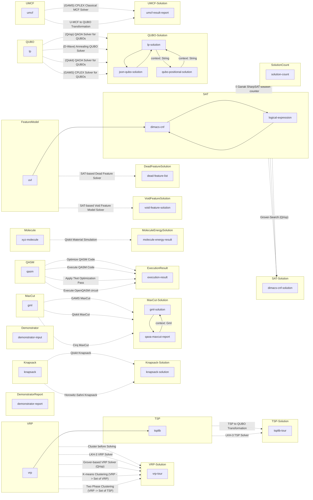

# Format Conversion Graph

Formats: 28, Conversions: 10, Solvers: 30

Boxes group the formats of a format family. Solid arrows are registered converters between formats,  where some additionally require the problem instance as context (labeled with the context type); dashed arrows are solvers, leading from a problem's input family to its result family.

